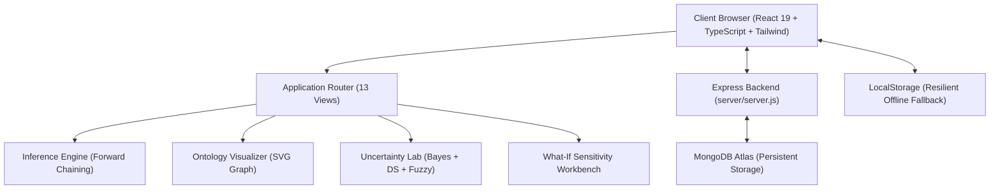

# SMART EMERGENCY TRIAGE SYSTEM
### An Intelligent Knowledge-Based System for Emergency Patient Prioritization

[](https://github.com/Gowthami0812/smart-emergency-triage-system)
[](https://github.com/Gowthami0812/smart-emergency-triage-system)
[](https://github.com/Gowthami0812/smart-emergency-triage-system)
[](https://github.com/Gowthami0812/smart-emergency-triage-system)
[](https://github.com/Gowthami0812/smart-emergency-triage-system)

---

## Academic Context & Problem Statement

> **Problem Statement:**  
> "An emergency department needs to prioritize patients based on symptoms, vital signs, medical history, and severity. How can knowledge representation and inference support this decision-making process?"

This project was engineered for the academic course **22ITE61 – Knowledge Engineering** (B.Tech Information Technology). It demonstrates how Knowledge Representation, Description Logic Ontologies, Forward-Chaining Production Rules, Uncertainty Reasoning, and Inductive Rule Learning solve the emergency triage prioritization problem in an explainable, transparent environment.

> [!IMPORTANT]
> **Educational Simulation Notice:**  
> This system is built strictly for academic demonstration and knowledge engineering evaluation. It is not a clinically validated medical device. Never use this application for actual clinical diagnosis or triage. Missing vital signs are never assumed to be normal, and lower urgency (Green) results do not imply delay is safe.

---

## 22ITE61 Syllabus Integration Matrix

| Unit | Course Focus | Implemented System Capabilities |
| :--- | :--- | :--- |
| **Unit 1** | **Reasoning Under Uncertainty** | Abductive reasoning (manifestation-to-etiology coverage), Bayesian belief updater ($P(H\|E)$), Dempster-Shafer theory (mass assignments & $[Bel, Pl]$ intervals), Fuzzy logic membership curves with Mamdani defuzzification, PEAS intelligent agent architecture, and Mixed-Initiative clinician overrides. |
| **Unit 2** | **Methodology and Modeling** | Inquiry-driven assessment, evidence believability scoring, assumption-based reasoning, and the interactive **What-If Analysis** differential simulation workbench. |
| **Unit 3** | **Ontologies: Design & Development** | Multi-axial clinical ontologies (Patient, Symptoms, Vitals, History, Priority), interactive SVG connected-nodes graph with zoom/pan, taxonomic generalization (`is_a`), transitivity of inheritance, and cross-ontology matching (SNOMED-CT, LOINC, ICD-10). |
| **Unit 4** | **Reasoning with Ontologies & Rules** | Forward-chaining production rule engine with working memory element assertions, conflict resolution, Synthesis rules vs Reduction rules, and full Rule Management CRUD with immediate inference impact. |
| **Unit 5** | **Learning and Rule Learning** | Inductive rule induction from cases, Generalization operators (condition removal, threshold relaxation), Specialization operators (constraint addition), and automated Knowledge Base Anomaly Detection (conflicts, redundancies, subsumption). |

---

## System Architecture



---

## Application Modules (13 Views)

1. **Landing Page**: Product hero section, problem statement, KE features overview, and workflow architecture.
2. **Dashboard**: Live calculated statistics cards, Recharts visualizations (Doughnut, Bar, Line charts), and searchable patient caseload table.
3. **Patient Assessment**: Multi-section intake form with quick viva case presets (Acute MI, Hemorrhagic Shock, Peritoneal Sepsis, Gastroenteritis, Tension Headache).
4. **Knowledge Base**: Conceptual browser for Unit 3 ontology concepts, semantic relations, and cross-ontology matching crosswalks.
5. **Ontology Visualizer**: Interactive SVG connected-node graph with zoom, pan, transitivity highlighter, and node attribute inspector.
6. **Inference Engine**: Step-by-step forward-chaining tracer displaying working memory facts, condition evaluations, and fired production rules.
7. **Uncertainty Lab**: Interactive laboratory for Abductive, Bayesian, Dempster-Shafer, and Fuzzy reasoning.
8. **Triage Results**: 4-tier color-coded clinical card (`RED`, `ORANGE`, `YELLOW`, `GREEN`) with explainable rationale, vital flags, and print support.
9. **Rule Management**: Production rule catalog with CRUD, enable/disable toggles, category filtering, and production system foundations.
10. **What-If Analysis**: Dual-panel workbench comparing baseline vs modified scenario with real-time differential rule re-inference.
11. **Rule Learning**: Rule refinement workshop, anomaly detector, inductive rule induction, and Unit 5 concepts.
12. **Patient History**: Archive of simulation cases with search, priority filtering, and batch re-evaluation with active rules.
13. **About Project**: Academic coursework credits, 22ITE61 syllabus matrix, and technology stack breakdown.

---

## Project Structure

```
smart-emergency-triage-system/
├── dist/                      # Production frontend build
├── public/                    # Static assets
├── server/                    # Node.js + Express Backend
│   ├── package.json           # Backend dependencies
│   ├── server.js              # Express REST API, CORS, MongoDB & inference
│   └── .env.example           # Backend environment template
├── src/
│   ├── components/            # Reusable UI (Sidebar, TopNavbar, Disclaimer)
│   ├── data/                  # Seed data (16 production rules, 12 patients, ontology)
│   ├── engine/                # Core reasoning engines (Inference, Bayes, Fuzzy, DS, Abductive, Learner)
│   ├── pages/                 # 13 Application views
│   ├── services/              # StorageService & ApiService
│   ├── types/                 # TypeScript interfaces
│   ├── App.tsx                # Main application component
│   ├── index.css              # Tailwind CSS styles
│   └── main.tsx               # Application entry point
├── render.yaml                # Render deployment blueprint
├── vercel.json                # Vercel deployment configuration
├── package.json               # Frontend dependencies
├── vite.config.ts             # Vite configuration
└── README.md                  # Project documentation
```

---

## Local Setup & Development

### 1. Prerequisites
- Node.js (v18+ or v20+)
- npm (v9+)
- Git

### 2. Frontend Setup
```bash
# Clone the repository
git clone https://github.com/Gowthami0812/smart-emergency-triage-system.git
cd smart-emergency-triage-system

# Install dependencies
npm install

# Start local development server
npm run dev
```
Open [http://localhost:5173](http://localhost:5173) in your browser.

### 3. Backend Setup (Optional)
```bash
cd server
npm install
npm start
```
The backend server runs on `http://localhost:5000` with health check at `http://localhost:5000/api/health`.

---

## Deployment Guide

### Frontend Deployment (Vercel)
1. Fork or push this repository to your GitHub account (`Gowthami0812/smart-emergency-triage-system`).
2. Log in to [Vercel](https://vercel.com/) and click **Add New Project**.
3. Import the `smart-emergency-triage-system` repository.
4. Settings:
   - **Framework Preset**: `Vite`
   - **Root Directory**: `./`
   - **Build Command**: `npm run build`
   - **Output Directory**: `dist`
5. Optional Environment Variable:
   - `VITE_API_URL`: Your deployed Render backend URL (e.g. `https://smart-emergency-triage-backend.onrender.com`)
6. Click **Deploy**.

### Backend Deployment (Render)
1. Log in to [Render](https://render.com/).
2. Click **New +** > **Web Service**.
3. Connect your GitHub repository `smart-emergency-triage-system`.
4. Settings:
   - **Root Directory**: `server`
   - **Environment**: `Node`
   - **Build Command**: `npm install`
   - **Start Command**: `npm start`
5. Environment Variables:
   - `PORT`: `10000`
   - `MONGODB_URI`: (Optional) Your MongoDB Atlas connection string. If omitted, the server automatically uses the built-in resilient in-memory store.
6. Click **Create Web Service**.

---

## Verification & Build Status
- **Build**: Tested with Vite 8 + React 19 + TypeScript (`npm run build` compiles with 0 errors).
- **Rule Verification**: Deterministic inference validated across all priority tiers (`RED`, `ORANGE`, `YELLOW`, `GREEN`).
- **Resilience**: Operates in standalone mode via LocalStorage or cloud-connected mode via Express + MongoDB Atlas.

---

## Academic Credits
- **Course**: 22ITE61 – Knowledge Engineering
- **Department**: Information Technology
- **Author**: Gowthami0812
